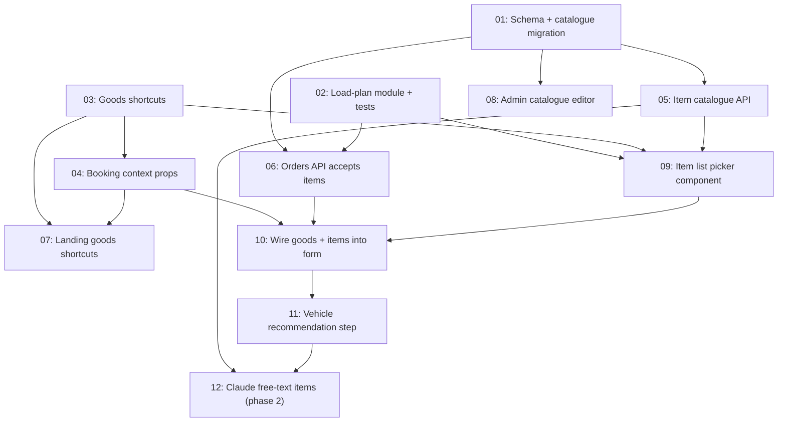

# Goods-first booking

## Overview

The client says what they are moving and the platform picks the vehicle. This replaces the booking form's vehicle-first questions: the total-weight bracket in step 4, the vehicle grid in step 5, and the exact weight and dimensions in step 6.

- **Goods shortcuts** replace vehicles as the entry point, on the landing page and in step 3.
- **An item list** (a seeded, admin-editable catalogue plus custom items) replaces the weight question. Business clients can also describe the load as **pallets**.
- **A pure load-plan module** derives weight, size, volume, cargo category, handling tags and (for individuals) load space from the list. It then recommends the cheapest vehicle that fits.
- **Business clients must choose a load space** (Dry box / Refrigerated / Open chassis). Individuals never see that question.
- **Claude free-text input** is a later phase (task-12).

Pricing does not change: a vehicle class is still priced by distance, time and helpers.

## Quick Links

- [Requirements](./requirements.md) — goals, decisions, acceptance criteria, fit heuristic
- [Action Required](./action-required.md) — sign-offs and manual steps

## Dependency Graph

## Waves

| Wave | Tasks | Description |
|------|-------|-------------|
| 1 | task-01, task-02, task-03 | Foundations with no file overlap: schema and catalogue data, the pure load-plan module, the shortcut table. |
| 2 | task-04, task-05, task-06, task-08 | Form plumbing (account type, initial shortcut; the only `booking-form.tsx` edit this wave), catalogue API, orders API (with the legacy path kept), admin editor. |
| 3 | task-07, task-09 | Landing page shortcuts; the item list picker, built standalone and unwired. |
| 4 | task-10 | Steps 3, 4 and 6 of the form switch to goods + items. |
| 5 | task-11 | Step 5 becomes a recommendation; business load space becomes required; crew suggestion. |
| 6 | task-12 | **Phase 2, not scheduled.** Claude parses free text into catalogue lines. |

**Waves 2, 4 and 5 each edit `src/components/home/booking-form.tsx` in exactly one task.** Do not parallelise inside it.

**Safe to deploy after every wave.** Task-06 keeps the current order path for requests without `items`, so the live form keeps working until task-10 switches it over. Removing that legacy path is an action-required item, done once cached clients have aged out.

Between waves 4 and 5 the form is consistent but not finished. Items drive the vehicle grid's filtering, but the grid is still the old full grid, without the recommendation card. Ship waves 4 and 5 together.

## Task Status

### Wave 1
- [x] [task-01-schema-and-catalogue](./tasks/task-01-schema-and-catalogue.md) — `ItemCatalogEntry`, `OrderItem`, `Order.cargoVolumeM3`, insert-only catalogue migration
- [x] [task-02-load-plan](./tasks/task-02-load-plan.md) — Pure derivation + recommendation module and its spec
- [x] [task-03-goods-shortcuts](./tasks/task-03-goods-shortcuts.md) — Shortcut table, icons, copy

### Wave 2
- [x] [task-04-booking-context-props](./tasks/task-04-booking-context-props.md) — `?goods=` via `HomeEntry`, account type via `/api/client-profile`; `/` stays cached
- [x] [task-05-item-catalogue-api](./tasks/task-05-item-catalogue-api.md) — `GET /api/item-catalogue?locale=` + client hook
- [x] [task-06-orders-api-items](./tasks/task-06-orders-api-items.md) — Accept `items[]` alongside the legacy path, re-derive, persist `OrderItem`, body-aware serviceability
- [x] [task-08-admin-catalogue](./tasks/task-08-admin-catalogue.md) — Admin CRUD for the catalogue

### Wave 3
- [x] [task-07-landing-goods-shortcuts](./tasks/task-07-landing-goods-shortcuts.md) — Goods shortcuts on the landing page, carried through sign-up
- [x] [task-09-item-list-picker](./tasks/task-09-item-list-picker.md) — Search, quantities, custom item, pallets mode, running summary

### Wave 4
- [x] [task-10-wire-goods-and-items](./tasks/task-10-wire-goods-and-items.md) — Steps 3, 4 and 6 switch over; submit items

### Wave 5
- [x] [task-11-vehicle-recommendation](./tasks/task-11-vehicle-recommendation.md) — Recommendation card, one size up, business load space required, crew hint

### Wave 6 — phase 2
- [ ] [task-12-claude-free-text-items](./tasks/task-12-claude-free-text-items.md) — "Describe what you're moving" → proposed catalogue lines
